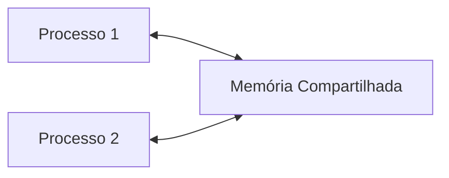

# Aula 04 -- Professor Jean: teoria e Mario: lab

---

**JEAN**

Usa o arquivo aula 03

Muita coisa para anotar antes

Seja lá o que veio antes a **LEI DE AMDAH** resolve, algo que envolve overhead(sobrecarga), speed-up, como estamos aproveitando os núcleos.


---

### Qual o speed-up máximo que posso ter com um programa?

Essa lei de Amdah responde isso.

#### Analogia:

Lei de Amdahl: A Reforma da Casa
Analogia
Imagine que você está reformando uma casa e contrata uma equipe de trabalhadores:
Tarefas Paralelizáveis: Pintar as paredes, assentar o piso. Pode colocar 10 pintores
trabalhando ao mesmo tempo e a tarefa terminará 10 vezes mais rápido.
Tarefas Seriais: Instalar o único quadro de disjuntores ou a única porta de entrada. Não
importa se tem 1 ou 100 eletricistas, apenas um pode trabalhar no quadro de cada vez.
Essa tarefa é um gargalo inerentemente sequencia


*O tempo total da reforma será sempre limitado pela duração das tarefas sequenciasi que nao podem ser divididos.*


A lei fornece uma fórmula que me permite calcular o maior speed-up possível:

S<sub>p</sub> = 1 / (f + (1 − f) / p)


Sp : Speedup teórico obtido com p processadores/núcleos
f : Fração do código que é inerentemente serial (não paralelizável) - valor entre 0 e 1
(1 − f ): Fração do código que pode ser paralelizada
p: Número de processadores/núcleos
Quanto menor a fração serial f , maior o speedup potencial!


## Exemplo:

Um programa leva 100 segundos para executar num único núcleo. Após análise:
20 segundos são gastos em tarefas seriais (leitura de configuração, inicialização)
80 segundos são de um cálculo que pode ser perfeitamente paralelizado


---

Usando o exemplo anterior (Tserial = 100s e f = 0, 2):
Calcule o speedup para p = 2, p = 8, p = 32 e p = ∞ &  Complete a tabela:


| p | S(p) | resultado|
|---|------|----------|
| 2 | ?    | **1.666**|
| 8 | ?    | **3.333**|
| 32 | ?   | **4.444**|
| ∞ | ?    | **5.000**|


O ganho aumenta pouco, no caso satura muito rápido, ou seja adicionar mais nucleos corresponde a beneficios menores


---
---
# Mário

Arquivo - Comunicação entre Processos com Memória Compartilhada

Regra básica, um processo não pode acessar uma memória que não o pertença, se tentar ele é encerrado com a mensagem *Segmentation Fault*


Uma outra técnica de comunicação entre processos é a **Memória compartilhada**, para funcionar se cria uma área específica de memória, adiciona as respectivas tabelas de páginas de processos, de modo que o acesso a estão região não seja mais considerada ilegal.


 comunicação entre o Processo 1 e o Processo 2 vai acontecer através da área de memória compartilhada. Nesta área, os processos criam variáveis que são utilizadas para a comunicação.




As etapas são as seguintes:

    Cria o segmento de memória compartilhada ou utiliza um já criado (shmget()).
    Anexa o processo ao segmento de memória compartilhada já criado (shmat()).
    Desanexa o processo do segmento de memória compartilhada já anexado (shmdt()).
    Controla operações no segmento de memória compartilhada (shmctl()).


### Funções utilizadas


### shmget()

*Ele cria ou aloca um segmento de memória compartilhada (System V)*

```
#include <sys/ipc.h>
#include <sys/shm.h>

int shmget(key_t key, size_t size, int shmflg)
```

Os argumentos são:

`key` -- reconhece o segmento de memória; pode ser um valor arbitrário ou pode ser derivado da biblioteca `ftok()`. Também pode ser `IPC_PRIVATE`, isto é, os processos serão executados em modelo servidor cliente (pai e filho)

`size` -- tamanho do segmento de memória que será alocado, arredondado a um múltiplo de `PAGE_SIZE` 

`shmflg`  -- especifica o(s) flag(s) de memória compartilhada requerida, tais como, `IPC_CREAT`, criando um novo segmento,   `IPC_EXCL`, usado com o `IPC_CREAT`,para criar um novo segmento, falhará se um segmento já existir. Também pode passar as permissões. 


### shmat()

Anexa o segmento de memória ao espaço de endereçamento do processo chamador.

```
#include <sys/types.h>
#include <sys/shm.h>

void `* shmat(int shmid, const void *shmaddr, int shmflg)
```

Os argumentos são:

*shmid* -- o identificador do segmento de memória compartilhada, é o retorno da função `shmget()`

*shamddr* -- para especificar o ednereço anexado. Se o `shamddr`  for `NULL` o sistema, por default, escolhe o endereço adequado para anexar o segmento.

*shmflg* -- especifica os flag(s) requeridos da memóra, tais como `SHM_RND`, arredondamento do endereço para `SHMLBA`. ou `SHM_EXEC`,permite o segmneot do conteúdo a ser executado, ou `SHM_RDONLY`, anexa o segmento apenas para leitura, ou `SHM_REMAP`, subistitui o mapeamento especificado por `shamddr` e continua até o final do sgmento. 

Esta função retorna o endereço do segmento de memória compartilhada anexado quando tem sucesso, ou -1 em caso de falha. O motivo da falha deve ser verificado na variável `errno` ou com a função `perror()`.


