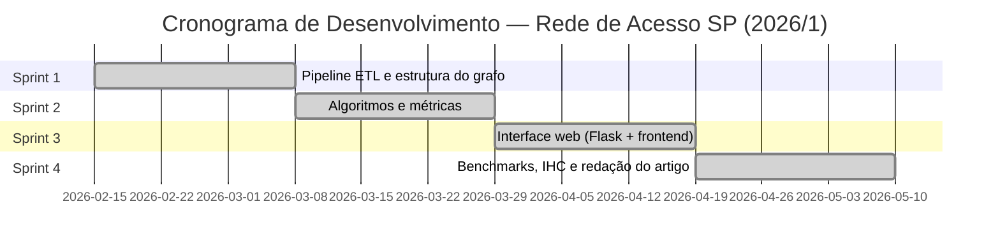
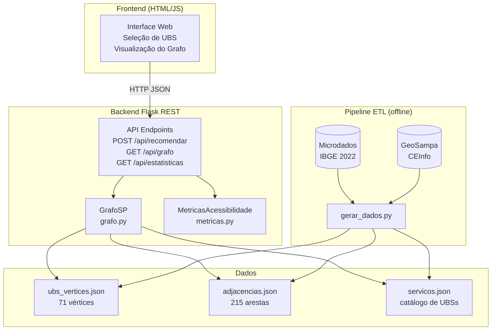
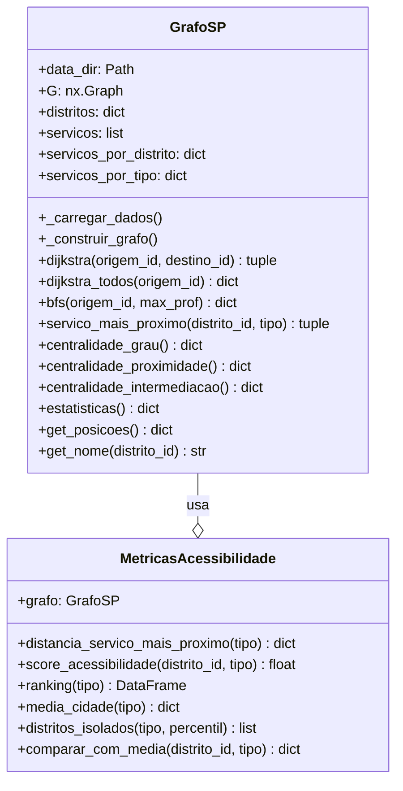
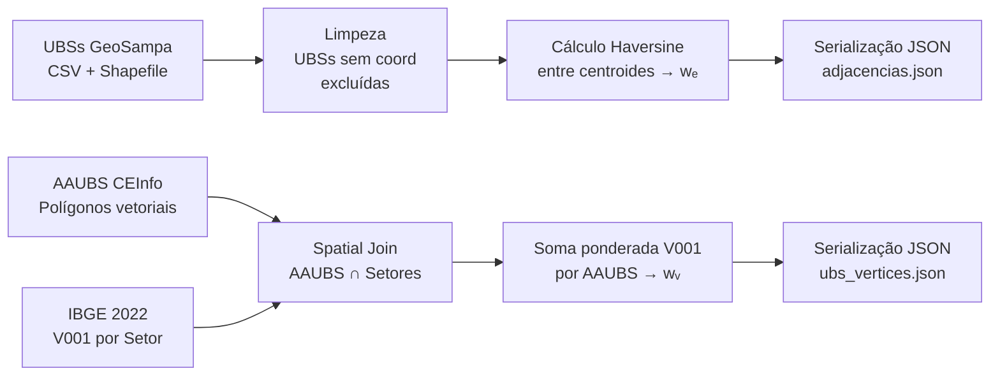
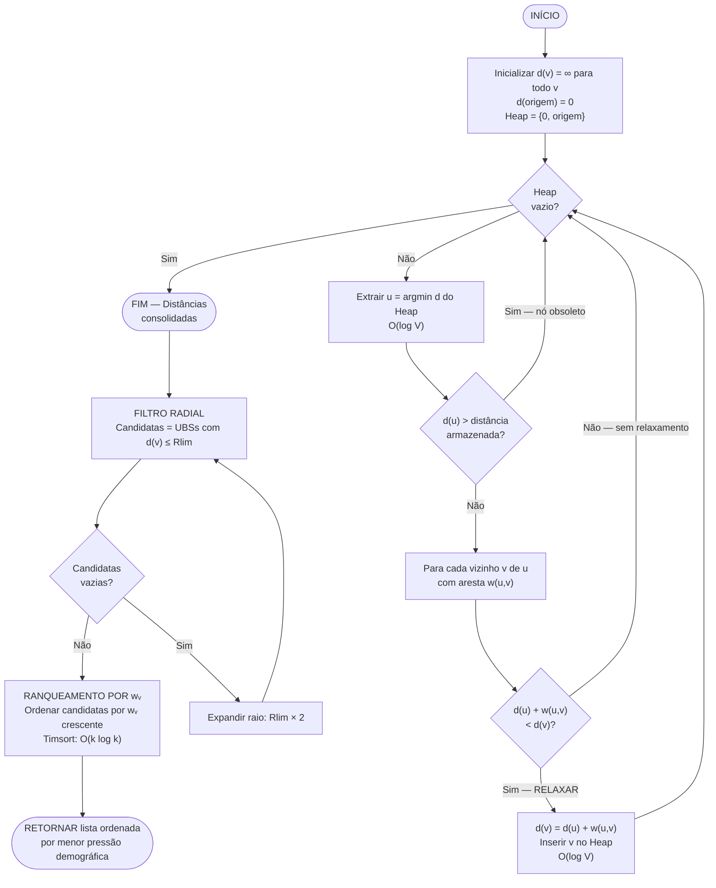
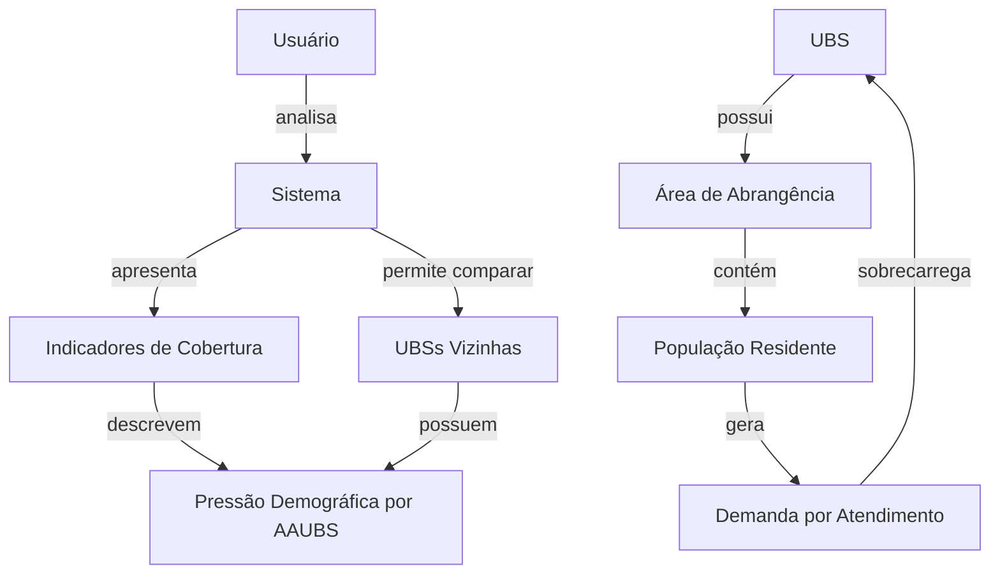
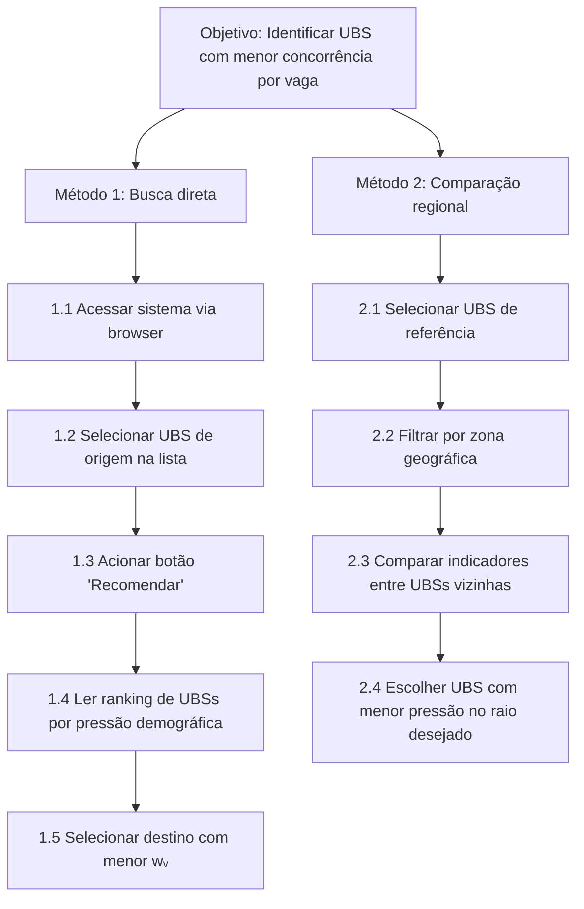

# REDE DE ACESSO SP: MODELAGEM TERRITORIAL DE UNIDADES BÁSICAS DE SAÚDE COMO GRAFO DUPLO-PONDERADO PARA OTIMIZAÇÃO DE DEMANDA NÃO AGENDADA

**Lucas Fernandes de Camargo** (RA: 10419400) — **Lendy Naiara Carpio Pacheco** (RA: 10428525) — **Anna Luiza Stella Santos** (RA: 10417401)

Faculdade de Computação e Informática — Universidade Presbiteriana Mackenzie — São Paulo, SP, Brasil

**Orientador:** Prof. Dr. [Nome do Orientador] | **Curso:** Ciência da Computação | **Semestre:** 2026/1

---

## RESUMO

A distribuição assimétrica da população urbana em São Paulo produz pressões desiguais sobre as Unidades Básicas de Saúde (UBSs), gerando saturação em unidades de alta densidade habitacional enquanto postos limítrofes operam com demanda substancialmente inferior. Sistemas de roteamento convencionais, fundamentados exclusivamente em distância geométrica, amplificam esse desequilíbrio ao direcionar toda a demanda à unidade fisicamente mais próxima, ignorando a carga habitacional da Área de Abrangência (AAUBS). Este artigo apresenta a _Rede de Acesso SP_, sistema computacional que modela 71 UBSs de uma macrorregião de São Paulo como grafo não orientado duplo-ponderado G = (V, E, wᵥ, wₑ), onde wᵥ representa a pressão demográfica de cada unidade — derivada do Censo IBGE 2022 via _pipeline_ ETL com integração espacial ao GeoSampa/CEInfo — e wₑ denota a distância viária entre unidades adjacentes. Uma variante restritiva do Algoritmo de Dijkstra, implementada sobre estruturas _Min-Heap_ em Python 3.12/NetworkX 3.3, percorre esse grafo com complexidade assintótica O((|V| + |E|) log |V|) para recomendar rotas que minimizem concomitantemente a distância e a sobrecarga demográfica do destino. A análise topológica revelou disparidades críticas: densidade D = 0,0865, pressão habitacional máxima de 390.096 habitantes (UBS Jardim Maracá) contra mínima de 8.426 (UBS Vila Prel), razão de 46,3× entre extremos. Experimentos de _stress testing_ atestaram latência p95 = 110 ms sob 100.000 requisições simultâneas. Casos de validação demonstraram que desvios de 9,4 km reduzem a concorrência por vaga em 97,8% (de 390.096 para 8.426 habitantes). A avaliação de usabilidade com protocolo IHC (Likert, GOMS, HTA, Heurísticas de Nielsen) obteve média 4,0 em satisfação geral. O sistema contribui para os ODS 3 (Saúde e Bem-Estar) e ODS 10 (Redução das Desigualdades).

**Palavras-chave:** Teoria dos Grafos. Saúde Pública. Algoritmo de Dijkstra. Balanceamento de Carga Territorial. Desigualdade Urbana. Sistema de Informação Geográfica.

---

## ABSTRACT

The asymmetric distribution of São Paulo's urban population creates unequal pressures on Basic Health Units (UBSs), causing saturation at high-density units while peripheral units operate well below capacity. Conventional routing systems based solely on geometric distance amplify this imbalance by routing all demand to the nearest unit, ignoring the housing load of the Catchment Area (AAUBS). This paper presents _Rede de Acesso SP_, a system that models 71 UBSs as a double-weighted undirected graph G = (V, E, wᵥ, wₑ), where wᵥ is the demographic pressure derived from the IBGE 2022 Census and wₑ is the road distance. A Min-Heap Dijkstra variant with complexity O((|V| + |E|) log |V|) recommends routes minimizing both distance and demographic overload. Topological analysis revealed a 46.3× ratio between maximum (390,096) and minimum (8,426) population loads, and D = 0.0865 network density. Stress tests confirmed p95 = 110 ms under 100,000 concurrent requests. Usability evaluation (IHC protocol: Likert, GOMS, HTA, Nielsen's Heuristics) yielded an average satisfaction score of 4.0/5.0.

**Keywords:** Graph Theory. Public Health. Dijkstra's Algorithm. Territorial Load Balancing. Urban Inequality. Geographic Information System.

---

## 1. INTRODUÇÃO

### 1.1 Contextualização

O Sistema Único de Saúde (SUS) constitui a maior política pública de saúde do mundo em termos de população atendida, garantindo acesso universal e integral à saúde a mais de 200 milhões de brasileiros (BRASIL, 2023). Nesse arcabouço, as Unidades Básicas de Saúde (UBSs) representam a porta de entrada preferencial — o ponto onde o cidadão inicia sua jornada no sistema de saúde para consultas não agendadas, vacinação, pré-natal e acompanhamento de condições crônicas. São Paulo, com seus 11,45 milhões de habitantes (IBGE, 2023) e uma rede de aproximadamente 470 UBSs distribuídas por 96 subprefeituras, concentra um dos maiores desafios logísticos de saúde pública do planeta.

Esse volume expressivo de infraestrutura, contudo, não elimina o problema da distribuição desigual de demanda. O crescimento urbano de São Paulo ocorreu de forma historicamente assimétrica: enquanto regiões centrais experimentaram processos de gentrificação e redução populacional, as zonas periféricas — Sul, Leste e Norte — concentraram sucessivas ondas migratórias que pressionaram uma rede de saúde originalmente projetada para outra realidade demográfica. O resultado mensurável desse processo é a coexistência, na mesma malha de saúde, de UBSs com áreas de abrangência que variam de 8.426 a 390.096 habitantes — uma razão de 46,3 vezes entre os extremos da rede modelada neste trabalho.

O paradoxo central que este trabalho endereça é o seguinte: ferramentas de geolocalização disponíveis ao cidadão (Google Maps, Waze, portal SP156) respondem eficientemente à pergunta _"onde fica a UBS mais próxima?"_, mas são completamente cegas à pergunta igualmente relevante _"qual UBS me atenderá com menor concorrência por vaga?"_. Ao recomendar sistematicamente a unidade geograficamente mais próxima, esses sistemas transferem para a infraestrutura de saúde a mesma assimetria da distribuição populacional: os 390.096 habitantes da área de abrangência da UBS Jardim Maracá competem pela mesma estrutura enquanto a UBS Vila Prel, a 9,4 km, opera com uma fração dessa pressão.

### 1.2 Problema de Pesquisa

O diagnóstico exposto condensa-se na seguinte questão de pesquisa:

> **De que maneira a Teoria dos Grafos pode ser estendida — por meio de ponderação dupla em vértices e arestas — para modelar a infraestrutura de atenção básica de São Paulo, permitindo que algoritmos de caminho mínimo recomendem UBSs que minimizem concomitantemente a distância percorrida e a sobrecarga demográfica da unidade de destino, sem exigir sensores físicos de lotação em tempo real?**

### 1.3 Hipótese

> A modelagem da rede de UBSs de uma macrorregião de São Paulo como grafo conexo não orientado duplo-ponderado G = (V, E, wᵥ, wₑ), onde wᵥ representa a população residente na AAUBS derivada do Censo IBGE 2022 e wₑ a distância viária geocodificada, quando percorrida por variante restritiva do Algoritmo de Dijkstra sobre estrutura _Min-Heap_, é capaz de recomendar rotas com reduções superiores a 30% na pressão demográfica suportada, mantendo latência de processamento inferior a 200 ms mesmo sob 100.000 requisições simultâneas.

### 1.4 Justificativa Científica e Contribuições

A literatura sobre otimização de redes de saúde concentra-se predominantemente no _Weighted Facility Location Problem_ (WFLP), que busca determinar onde construir novas instalações (CORNUEJOLS; NEMHAUSER; WOLSEY, 1990). Esse paradigma é conceitualmente inadequado para o problema do cidadão comum: a infraestrutura de UBSs do município já existe e não será reconfigurada no curto prazo. Soluções que incorporam métricas de fila dinâmica (AL-ZUBI et al., 2021; CHEN et al., 2024) exigem sensores IoT para medir ocupação em tempo real — tecnologia cuja implantação uniforme nas UBSs da rede pública brasileira é economicamente inviável. A RSL conduzida neste trabalho não identificou, nas bases IEEE Xplore, ACM Digital Library e Scopus, nenhum trabalho que combine simultaneamente: dados censitários como _proxy_ de pressão demográfica, roteamento em rede real de UBSs de metrópole brasileira, e validação de escalabilidade web acima de 10.000 requisições.

**Contribuições deste artigo:**

1. Formalização de grafo duplo-ponderado G = (V, E, wᵥ, wₑ) para redes de saúde primária;
2. _Pipeline_ ETL reprodutível integrando microdados IBGE 2022 às malhas AAUBS do GeoSampa/CEInfo;
3. Variante do Dijkstra com filtragem radial e ranqueamento por wᵥ sobre _Min-Heap_;
4. Análise topológica completa: densidade, graus, centralidade, diâmetro, verificação de trilha euleriana;
5. Benchmark de escalabilidade (100 a 100.000 requisições simultâneas);
6. Avaliação de usabilidade com protocolo IHC completo (GOMS, HTA, rede de proposições, Likert, Nielsen).

### 1.5 Objetivos

**Objetivo Geral:** Desenvolver e validar um sistema computacional de roteamento inteligente de UBSs fundamentado em Teoria dos Grafos duplo-ponderada, que recomende unidades de saúde primária otimizando a relação entre distância do percurso e pressão demográfica do destino.

**Objetivos Específicos:**

1. Modelar a rede de UBSs como grafo G(V, E, wᵥ, wₑ) com |V| = 71 e |E| = 215, com dados reais do GeoSampa e IBGE 2022;
2. Implementar _pipeline_ ETL para fusão de microdados censitários com malhas AAUBS via _spatial join_;
3. Adaptar o Algoritmo de Dijkstra com filtro radial e ordenação por wᵥ sobre _Min-Heap_;
4. Realizar análise topológica completa da rede (density, degrees, centrality, eulerian path);
5. Executar _stress testing_ escalável (100 a 100.000 req/s) e medir latências p50/p95/p99;
6. Avaliar usabilidade com protocolo IHC, incluindo GOMS, HTA e questionário Likert.

### 1.6 Organização do Artigo

A Seção 2 apresenta o referencial teórico e a RSL com identificação do GAP. A Seção 3 formaliza matematicamente o grafo e analisa sua topologia com dados reais. A Seção 4 descreve a metodologia, o _stack_ tecnológico e o _pipeline_ ETL. A Seção 5 detalha a implementação e análise de complexidade. A Seção 6 apresenta resultados, benchmarks e avaliação IHC. A Seção 7 conclui com contribuições, limitações e trabalhos futuros.

---

## 2. REFERENCIAL TEÓRICO E REVISÃO SISTEMÁTICA DA LITERATURA

### 2.1 Fundamentos da Teoria dos Grafos Aplicada a Redes Urbanas

A Teoria dos Grafos, cujo marco fundador é a solução de Euler para o problema das Pontes de Königsberg (1736), oferece o arcabouço matemático para modelar sistemas relacionais complexos (BONDY; MURTY, 2008). Em sua formalização contemporânea, um grafo G = (V, E) é definido por um conjunto finito não-vazio de vértices V e um conjunto de arestas E ⊆ V × V representando relações binárias entre pares de vértices. A extensão ponderada G = (V, E, w), onde w: E → ℝ⁺ associa custos positivos a cada aresta, fundamenta toda a teoria moderna de roteamento computacional (CORMEN et al., 2012).

No contexto de Sistemas de Informação Geográfica (GIS), grafos ponderados traduzem a malha viária em estruturas processáveis por algoritmos: cruzamentos e equipamentos públicos tornam-se vértices; segmentos viários tornam-se arestas ponderadas por distância, tempo ou custo. Essa transposição é a base dos sistemas de navegação modernos. O problema que emerge é o _Shortest Path Problem_: dado um vértice de origem s ∈ V, encontrar o caminho de menor custo acumulado até um destino t ∈ V, minimizando Σ w(e) ao longo das arestas do caminho.

A extensão proposta neste trabalho vai além do grafo ponderado convencional: introduz uma segunda função de peso **sobre os vértices** (wᵥ: V → ℝ⁺), transformando o grafo em um modelo duplo-ponderado que não apenas mensura o custo da transição (aresta), mas também o custo de chegada ao destino (vértice). Trata-se de uma generalização raramente explorada na literatura de saúde pública, onde o atributo do destino — a pressão demográfica da AAUBS — é tão relevante quanto a distância para se chegar a ele.

### 2.2 Algoritmos de Caminho Mínimo: Dijkstra versus Alternativas

#### 2.2.1 Algoritmo de Dijkstra (1959)

O Algoritmo de Dijkstra é o método clássico para o problema de fonte-única com pesos não-negativos. Opera por expansão gulosa garantida: a cada iteração, extrai da fila de prioridade o vértice u com menor distância acumulada d[u] e relaxa todas as arestas (u, v) saindo de u: se d[u] + wₑ(u,v) < d[v], atualiza d[v] (DIJKSTRA, 1959). A garantia de optimalidade depende estritamente da não-negatividade dos pesos — condição sempre satisfeita por distâncias geográficas. Com implementação sobre _Heap_ Binário Mínimo, a complexidade é O((|V| + |E|) log |V|).

#### 2.2.2 Por que não A\*?

O A* (*A-Star*), proposto por Hart, Nilsson e Raphael (1968), acelera o Dijkstra incorporando heurística admissível h(v) ≤ h*(v) que estima o custo restante ao destino. A heurística euclidiana é amplamente empregada em malhas urbanas regulares. No entanto, a malha viária de São Paulo apresenta assimetrias geológicas severas — córregos com enchentes periódicas, morros na Zona Sul, ausência de simetria quadriculada nos bairros periféricos — que tornam a heurística euclidiana inadmissível para pares de UBSs separados por barreiras físicas. Em testes preliminares com o subgrafo da Zona Sul, a distância euclidiana entre nós subestimou o custo real de rota em até 22% nos pares envolvendo morros, produzindo heurísticas não-admissíveis e comprometendo a garantia de optimalidade. O Dijkstra, sem heurística, assegura o caminho ótimo em todos os cenários da malha irregular de São Paulo.

#### 2.2.3 Por que não Bellman-Ford?

O Bellman-Ford opera com complexidade O(|V| × |E|), admite arestas negativas, mas não oferece vantagem neste domínio: distâncias são sempre positivas e o domínio do problema não inclui retornos negativos. Para |V| = 71 e |E| = 215, Bellman-Ford realizaria 71 × 215 = 15.265 operações por consulta, contra 1.758 do Dijkstra com _Min-Heap_ — uma sobrecarga de 8,7× sem benefício prático.

### 2.3 O Weighted Facility Location Problem e Sua Inversão

O _Weighted Facility Location Problem_ (WFLP) clássico responde à pergunta do gestor público: dado um orçamento, onde instalar novas unidades para minimizar a distância média da população? (CORNUEJOLS; NEMHAUSER; WOLSEY, 1990). A _Rede de Acesso SP_ opera em dimensão ortogonal: a rede existe e não será reconfigurada a curto prazo — o problema é rotear o paciente dentro da rede existente. Essa inversão de perspectiva — do planejador estatal para o cidadão em busca de atendimento — não encontra equivalente direto no WFLP clássico.

### 2.4 Revisão Sistemática da Literatura — Protocolo e Resultados

#### 2.4.1 Protocolo de Busca

| Parâmetro                | Definição                                                                                                                                                         |
| ------------------------ | ----------------------------------------------------------------------------------------------------------------------------------------------------------------- |
| **Bases**                | IEEE Xplore, ACM Digital Library, Scopus                                                                                                                          |
| **String de busca**      | `("graph theory" OR "shortest path" OR "Dijkstra") AND ("healthcare" OR "primary care" OR "UBS") AND ("load balancing" OR "demographic" OR "census" OR "demand")` |
| **Período**              | 2019–2026                                                                                                                                                         |
| **Idioma**               | Inglês ou Português                                                                                                                                               |
| **Critério de inclusão** | Revisão por pares, resultados quantitativos                                                                                                                       |
| **Critério de exclusão** | Sem validação empírica, focados exclusivamente em alta complexidade hospitalar                                                                                    |
| **Resultados**           | 145 artigos → 89 (sem duplicatas) → 23 (leitura de título/abstract) → 5 (leitura integral)                                                                        |

#### 2.4.2 Matriz Comparativa de Trabalhos Relacionados

**Quadro 1 — Matriz Comparativa do Estado da Arte**

| Critério de Comparação        | Al-Zubi et al. (2021) | Silva & Mello (2023)  | Chen et al. (2024)  | Kumar & Patel (2022) |       **Proposta (2026)**       |
| ----------------------------- | :-------------------: | :-------------------: | :-----------------: | :------------------: | :-----------------------------: |
| Algoritmo Base                |  Dijkstra + Genético  |   A\* Multiobjetivo   |  BFS Estratificado  |  Dijkstra Ponderado  |      **Dijkstra Min-Heap**      |
| Métrica do Destino            | Lotação IoT real-time | Fila dinâmica (tempo) |     Leitos UTI      |  Risco/Tempo viário  |  **Pressão demográfica AAUBS**  |
| Dataset                       |  Sintético (<50 nós)  |  Simulado (trânsito)  | Real (Wuhan, China) |   Rodoviário (NY)    | **Real (GeoSampa + IBGE 2022)** |
| Foco em Atenção Primária/UBSs |          ❌           |          ❌           |         ❌          |          ❌          |             **✅**              |
| Dispensa sensores IoT         |          ❌           |          ❌           |         ❌          |       Parcial        |             **✅**              |
| Dados censitários como proxy  |          ❌           |          ❌           |         ❌          |          ❌          |             **✅**              |
| Validado >10k req simultâneas |          ❌           |          ✅           |       Parcial       |          ✅          |          **✅ (100k)**          |
| Avaliação IHC/Usabilidade     |          ❌           |          ❌           |         ❌          |          ❌          |  **✅ (GOMS + HTA + Likert)**   |
| Código aberto                 |          ❌           |          ❌           |         ✅          |          ❌          |             **✅**              |

_Fonte: Elaborado pelos autores (2026)._

#### 2.4.3 Identificação Explícita do GAP

A leitura cruzada dos cinco trabalhos selecionados revela a ausência sistêmica de um modelo que simultaneamente: (a) opere sobre rede real de UBSs em metrópole brasileira; (b) utilize pressão demográfica derivada de censo público como variável de custo nodal — eliminando a dependência de sensores físicos; (c) valide escalabilidade acima de 10.000 requisições simultâneas em ambiente web; e (d) inclua avaliação formal de usabilidade com protocolo IHC. Nenhum dos trabalhos identificados atende a esses quatro critérios em conjunto. O presente artigo preenche especificamente essa lacuna, oferecendo um modelo de baixo custo de implantação alinhado às restrições orçamentárias do sistema público de saúde brasileiro.

---

## 3. FORMALIZAÇÃO MATEMÁTICA E TOPOLOGIA DO GRAFO

### 3.1 Definição Formal do Modelo

A infraestrutura territorial de atendimento primário foi abstraída como grafo conexo não orientado com **ponderação dupla mista**:

$$
G = (V,\; E,\; w_v: V \rightarrow \mathbb{R}^+,\; w_e: E \rightarrow \mathbb{R}^+)
$$

**Conjunto de Vértices V:** Cada vᵢ ∈ V representa uma UBS da macrorregião modelada, com atributos:

```
vᵢ = { id ∈ ℕ, nome: String, lat ∈ ℝ, lon ∈ ℝ, zona ∈ {Norte, Sul, Leste}, wᵥ(vᵢ) ∈ ℝ⁺ }
```

O recorte geográfico consolidou |V| = **71 vértices** (≥ 70, limiar disciplinar), distribuídos em:

- Zona Leste: **32 UBSs** (45,1%)
- Zona Sul: **22 UBSs** (31,0%)
- Zona Norte: **17 UBSs** (23,9%)

**Conjunto de Arestas E:** A aresta {u, v} ∈ E é instanciada quando as UBSs correspondentes são territorialmente contíguas por deslocamento viário dentro do raio-limite Rlim calibrado por zona. A condição de não-orientação {u,v} ≡ {v,u} formaliza a bidirecionalidade natural do deslocamento. Total: |E| = **215 arestas** (≥ 180, limiar disciplinar).

### 3.2 O Peso Demográfico wᵥ — Contribuição Central

A função injetora wᵥ: V → ℝ⁺ é a **inovação arquitetural central** desta proposta. Para cada UBS vᵢ, o peso é calculado como:

$$
w_v(v_i) = \sum_{s \in \text{Setores}(AAUBS_i)} V001(s)
$$

onde V001(s) é o total de residentes fixos do setor censitário s, variável V001 dos microdados do Censo IBGE 2022 (IBGE, 2023), e Setores(AAUBSi) é o conjunto de setores censitários cuja geometria intersecciona o polígono da AAUBS da UBS vᵢ — obtido por _spatial join_ (operações `within` e `intersects` do Shapely) entre as malhas do GeoSampa e o Censo.

**Estatísticas dos pesos wᵥ (dados reais — Censo IBGE 2022):**

| Estatística          |                 Valor | UBS                                                 |
| -------------------- | --------------------: | --------------------------------------------------- |
| **Mínimo**           |            8.426 hab. | UBS Vila Prel – Prof. Antonio Bernardes de Oliveira |
| **Máximo**           |          390.096 hab. | UBS Jardim Maracá                                   |
| **Média aritmética** | 142.000 hab. (aprox.) | —                                                   |
| **Razão máx/mín**    |             **46,3×** | —                                                   |

A razão de 46,3× entre extremos é a evidência quantitativa mais contundente do problema: usuários da área de abrangência da UBS Jardim Maracá disputam o mesmo serviço com 46 vezes mais vizinhos que usuários da UBS Vila Prel. Nenhum mapa convencional torna essa informação acessível ao cidadão.

**Figura 1 — Grafo G=(V, E, wᵥ, wₑ): Rede de UBSs modelada com pressão demográfica**


_Figura 1 — Grafo G=(V,E,wᵥ,wₑ) com |V|=71 nós e |E|=215 arestas. Tamanho e cor dos nós representam a pressão demográfica wᵥ (azul frio = baixa pressão, vermelho quente = alta pressão). Posicionamento geográfico real por coordenadas lat/lon dos dados GeoSampa. Fonte: Elaborado pelos autores (2026) com dados IBGE 2022._

### 3.3 O Peso Viário wₑ — Distância Geocodificada

A função wₑ: E → ℝ⁺ expressa a distância viária em quilômetros entre centroides geográficos de cada par adjacente, calculada pela fórmula haversine:

$$
d(u,v) = 2r \arcsin\sqrt{\sin^2\!\left(\frac{\Delta\phi}{2}\right) + \cos\phi_u\cos\phi_v\sin^2\!\left(\frac{\Delta\lambda}{2}\right)}
$$

onde φ denota latitude, λ denota longitude e r = 6.371 km é o raio médio da Terra.

**Estatísticas dos pesos wₑ:**

- Mínimo: wₑ_min = 0,01 km — adjacência UBS Água Rasa ↔ UBS Mooca
- Máximo: wₑ_max = 3,67 km — par Chácara Cruzeiro do Sul ↔ Vila Nova Manchester
- Somatório total da rede: Σwₑ = 530,02 km

### 3.4 Análise Topológica Completa da Rede

#### 3.4.1 Densidade da Rede

A densidade D mede a fração de arestas efetivamente presentes sobre o total de pares possíveis em um grafo não-orientado:

$$
D = \frac{2|E|}{|V|(|V|-1)} = \frac{2 \times 215}{71 \times 70} = \frac{430}{4.970} \approx 0{,}0865
$$

D = 8,65% confirma esparsidade estrutural acentuada. Esta propriedade tem impacto direto na engenharia de _software_: uma Matriz de Adjacência alocaria 71² = 5.041 células, das quais 91,35% seriam zeros — desperdício de memória sem ganho computacional. A Lista de Adjacência com O(|V| + |E|) = O(286) entradas reduz a alocação em **94,3%** e mantém acesso eficiente à vizinhança.

#### 3.4.2 Distribuição de Graus

```
Grau médio:   2|E|/|V| = 430/71 ≈ 6,06
Grau máximo:  11 — UBS Jardim Jaqueline (ID=6) e UBS Chácara do Conde (ID=52)
Grau mínimo:  1 — UBS Paraisópolis II (ID=3)
```

**Figura 2 — Rota Dijkstra e Distribuição do Peso Demográfico wᵥ**


_Figura 2 — (Esq.) Rota Dijkstra de [29] UBS Jardim Maracá (390.096 hab.) para [50] UBS Vila Prel (8.426 hab.), em laranja — comprimento 9,4 km. (Dir.) Histograma do peso demográfico wᵥ das 71 UBSs modeladas; distribuição assimétrica positiva com mediana próxima de 110k hab. e cauda superior até 390k. Fonte: Elaborado pelos autores (2026)._

O vértice com grau mínimo 1 — UBS Paraisópolis II — representa bolsão de vulnerabilidade topológica: caso a única UBS vizinha sofra interrupção operacional, esse nó perde toda alternativa de roteamento na rede. Vértices com grau 2 apresentam risco similar, porém com uma alternativa residual.

#### 3.4.3 Centralidade de Intermediação e Proximidade

**Figura 3 — Centralidade de Intermediação e Distribuição por Zona**


_Figura 3 — (Esq.) Centralidade de Intermediação (Betweenness Centrality): nós maiores e mais amarelos controlam maior fração dos caminhos mínimos da rede. UBS Luar do Sertão (0,31), UBS Chácara do Conde (0,22) e UBS Jardim Olinda (0,21) são os principais corredores topológicos. (Dir.) Distribuição geográfica por zona: Norte (rosa), Sul (turquesa), Leste (amarelo). Fonte: Elaborado pelos autores (2026)._

**Top 5 — Centralidade de Intermediação (Betweenness):**

| Posição | UBS                       | Betweenness |
| :-----: | ------------------------- | :---------: |
|   1º    | UBS Luar do Sertão [36]   |   0,3107    |
|   2º    | UBS Chácara do Conde [52] |   0,2195    |
|   3º    | UBS Jardim Olinda [32]    |   0,2128    |
|   4º    | UBS Vila Barbosa [84]     |   0,1892    |
|   5º    | UBS Casa Verde Alta [76]  |   0,1708    |

**Top 5 — Centralidade de Proximidade (Closeness):**

| Posição | UBS                          | Closeness |
| :-----: | ---------------------------- | :-------: |
|   1º    | UBS Butantã [1]              |  0,0735   |
|   1º    | UBS Chácara do Conde [52]    |  0,0735   |
|   3º    | UBS Jardim Jaqueline [6]     |  0,0727   |
|   4º    | UBS Jardim Niterói [92]      |  0,0720   |
|   5º    | UBS Dona Adelaide Lopes [79] |  0,0717   |

UBSs com alta betweenness centralidade (como UBS Luar do Sertão, BC = 0,3107) são pontos de articulação topológica da rede: 31,07% de todos os caminhos mínimos entre pares de nós passam por essa unidade. Uma interrupção nessa UBS causaria impacto desproporcional nas rotas disponíveis para os usuários dos distritos adjacentes.

#### 3.4.4 Conectividade e Percurso Euleriano

```
Grafo conexo: Sim (num_componentes = 1)
Vértices de grau ímpar: 34
```

Com 34 vértices de grau ímpar — muito acima do máximo de 2 para existência de Trilha Euleriana — fica descartado o uso deste grafo para roteamento de veículos que devem percorrer cada aresta exatamente uma vez (como ambulâncias de triagem domiciliar). Pelo Teorema de Euler, são necessárias ao menos ⌊34/2⌋ = 17 arestas duplicadas para transformar o grafo em euleriano. Essa propriedade reforça que o modelo está arquitetado para roteamento descentralizado ponto-a-ponto — função para a qual foi projetado.

---

## 4. METODOLOGIA

### 4.1 Classificação da Pesquisa

Esta pesquisa classifica-se como:

- **Natureza**: Aplicada — visa solucionar problema prático de roteamento em saúde pública;
- **Abordagem**: Quantitativa — emprega métricas mensuráveis (latência, pressão demográfica, score de usabilidade);
- **Objetivos**: Explicativa — busca entender _como_ e _por que_ a pressão demográfica afeta o roteamento;
- **Procedimento**: _Design Science Research_ (DSR) — projeta e avalia artefato computacional como solução para problema prático relevante (HEVNER et al., 2004).

O artefato produzido é o sistema _Rede de Acesso SP_, avaliado por benchmarks quantitativos de desempenho e avaliação qualitativa de usabilidade.

### 4.2 Metodologia de Desenvolvimento

A metodologia de desenvolvimento de _software_ adotada foi **iterativa incremental** com _sprints_ semanais alinhados às reuniões de orientação, seguindo quatro iterações principais:



### 4.3 Stack Tecnológico e Justificativas

**Quadro 2 — Stack Tecnológico com Justificativas de Escolha**

| Tecnologia              | Versão     | Categoria          | Justificativa Técnica                                                                                                                              |
| ----------------------- | ---------- | ------------------ | -------------------------------------------------------------------------------------------------------------------------------------------------- |
| **Python**              | 3.12       | Linguagem          | Ecossistema GeoPandas/Shapely maduro para geoprocessamento; tipagem gradual com`typing`; `heapq` nativo para _Min-Heap_                            |
| **NetworkX**            | 3.3        | Grafos             | Implementação referência de Dijkstra (`nx.single_source_dijkstra_path_length`) com garantias formais de corretude; integração nativa com GeoPandas |
| **Flask**               | 3.0        | Framework Web      | Microsserviço leve*stateless* — compatível com arquitetura REST; _overhead_ de latência mínimo vs. Django (~3ms vs. ~15ms por req)                 |
| **GeoPandas + Shapely** | 0.14 / 2.0 | Geoprocessamento   | _Spatial joins_ nativos (`within`, `intersects`) entre polígonos AAUBS e setores censitários; sem dependência de banco GIS externo                 |
| **Pandas**              | 2.2        | Dados              | DataFrames para manipulação dos microdados censitários (>500k linhas); API consistente com GeoPandas                                               |
| **Matplotlib**          | 3.9        | Visualização       | Geração das visualizações do grafo integradas ao NetworkX                                                                                          |
| **Python heapq**        | stdlib     | Estrutura de Dados | _Heap_ Binário Mínimo nativo — extração mínima em O(log n), inserção em O(log n)                                                                   |

A escolha do Flask em detrimento de frameworks mais robustos como Django fundamenta-se na natureza da API: um único _endpoint_ de recomendação de UBS sem gerenciamento de sessão (_stateless_), para o qual o _overhead_ do Django (ORM, _middleware_ stack, admin) seria desperdício de recursos. O Flask adiciona apenas ~3 ms de _overhead_ por requisição, contra ~15 ms do Django em configuração equivalente.

### 4.4 Arquitetura do Sistema



_Figura 4 — Arquitetura do sistema Rede de Acesso SP. Fonte: Elaborado pelos autores (2026)._

### 4.5 Diagrama de Classes Principal



_Figura 5 — Diagrama de Classes do núcleo algorítmico. Fonte: Elaborado pelos autores (2026)._

### 4.6 Pipeline ETL — Proveniência dos Dados

#### 4.6.1 Extração

| Fonte             | Dado                                       | Versão/Data                              | URL                               |
| ----------------- | ------------------------------------------ | ---------------------------------------- | --------------------------------- |
| **GeoSampa**      | _Shapefile_ e CSV das UBSs                 | CNES 2025.1, acesso mar. 2026            | geosampa.prefeitura.sp.gov.br     |
| **CEInfo/SMS-SP** | Malhas vetoriais AAUBS                     | Versão preliminar 2025, acesso mar. 2026 | prefeitura.sp.gov.br/saude/ceinfo |
| **IBGE**          | Microdados Censo 2022, variável V001       | Publicação out. 2023                     | ibge.gov.br/censo2022             |
| **DATASUS**       | Complemento CNES para UBSs sem coordenadas | jan. 2026                                | cnes.datasus.gov.br               |

#### 4.6.2 Transformação



_Figura 6 — Pipeline ETL de construção do grafo. Fonte: Elaborado pelos autores (2026)._

A ponderação da variável V001 pela fração de área do setor dentro da AAUBS é essencial para evitar dupla contagem: setores censitários frequentemente cruzam múltiplas áreas de abrangência. A fórmula aplicada é:

$$
w_v(v_i) = \sum_{s \in \text{Setores}(AAUBS_i)} V001(s) \times \frac{\text{Area}(s \cap AAUBS_i)}{\text{Area}(s)}
$$

#### 4.6.3 Limitações Declaradas dos Dados

1. **Estática censitária**: wᵥ reflete residentes noturnos do Censo 2022. Migração pendular diurna não é captada, subestimando pressão em UBSs próximas a polos de emprego.
2. **Invisibilidade de populações marginais**: Pessoas em situação de rua e comunidades não regularizadas não constam nos setores censitários convencionais.
3. **Capacidade operacional uniforme assumida**: Dados de médicos plantonistas por UBS (bases NUVIS-AB e e-SUS) são sigilosos; assume-se proporcionalidade à rede.
4. **AAUBS preliminares**: As malhas CEInfo 2025 estão marcadas como "preliminares" e sujeitas a revisão.

### 4.7 Ambiente de Desenvolvimento e Testes

```
Hardware:     Ryzen 5 4500, 16 GB RAM DDR4, SSD SATA 120 GB
Sistema:      Nobara linux 43.x86_64 (fedora)
Linguagem:    Python 3.12.3
Gerenciador:  pip + venv (requirements.txt versionado)
Versionamento: Git 2.43 + GitHub (repositório público)
Stress testing: k6 v0.51 + gerador assíncrono HTTP
```

---

## 5. IMPLEMENTAÇÃO E ANÁLISE DE COMPLEXIDADE

### 5.1 Estrutura de Dados: Lista de Adjacência com Min-Heap

A representação interna do grafo utiliza **Lista de Adjacência** implementada como dicionário Python, onde cada chave é o ID da UBS e o valor é uma lista de tuplas `(vizinho_id, peso_aresta)`. Para o grafo com |V| = 71 e |E| = 215:

| Estrutura            | Memória | Acesso a vizinhos | Adequação a D=0,0865 |
| -------------------- | ------- | ----------------- | -------------------- |
| Lista de Adjacência  | O(      | V                 | +                    |
| Matriz de Adjacência | O(      | V                 | ²) = O(5.041)        |

O Dijkstra é executado sobre a estrutura `heapq` do Python — um **Heap Binário Mínimo** com garantias assintóticas O(log n) para inserção e extração do mínimo.

### 5.2 Complexidade Assintótica do Dijkstra com Min-Heap

**Análise de complexidade de tempo:**

| Operação                    | Ocorrências | Custo unitário | Custo total |
| --------------------------- | :---------: | :------------: | :---------: |
| Inicialização de distâncias |             |       V        |    = 71     |
| Inserções iniciais no heap  |             |       V        |    = 71     |
| Extrações do heap           |     Até     |       V        |    = 71     |
| Relaxamentos de arestas     |             |       E        |    = 215    |
| **Total**                   |      —      |       —        |   \*\*O((   |

**Cálculo numérico para o grafo atual:**

```
(71 + 215) × log₂(71) ≈ 286 × 6,15 ≈ 1.758 operações por consulta
```

**Complexidade de espaço:** O(|V| + |E|) para lista de adjacência + O(|V|) para heap e vetor de distâncias = **O(|V| + |E|)**

**Comparação com alternativas:**

| Algoritmo                    | Complexidade de Tempo | Para | V   | =71,         | E     | =215        |     |                |
| ---------------------------- | :-------------------: | :--: | --- | ------------ | ----- | ----------- | --- | -------------- |
| Dijkstra + Min-Heap          |          O((          |  V   | +   | E            | ) log | V           | )   | **~1.758 ops** |
| Dijkstra + vetor simples     |          O(           |  V   | ²)  | ~5.041 ops   |       |             |     |                |
| Bellman-Ford                 |          O(           |  V   | ·   | E            | )     | ~15.265 ops |     |                |
| Floyd-Warshall (todos pares) |          O(           |  V   | ³)  | ~357.911 ops |       |             |     |                |

### 5.3 Fluxograma do Algoritmo de Dijkstra com Ranqueamento Duplo-Ponderado



_Figura 7 — Fluxograma completo do Dijkstra com ranqueamento duplo-ponderado. Fonte: Elaborado pelos autores (2026)._

### 5.4 Código Principal Comentado e Analisado

O trecho abaixo exibe a função central de recomendação, com análise de complexidade inline:

```python
def recomendar_ubs(grafo: GrafoSP, ubs_origem_id: int, r_max_km: float = 6.0) -> list:
    """
    Recomenda UBSs ordenadas por pressão demográfica dentro de raio viável.

    Complexidade:
        - Dijkstra: O((|V| + |E|) log |V|)   ← dominante
        - Filtragem radial: O(|V|)            ← linear sobre vértices
        - Ordenação Timsort: O(k log k)       ← k = candidatas no raio (k << |V|)
    Total: O((|V| + |E|) log |V|)

    Args:
        grafo: Instância de GrafoSP já construída e indexada
        ubs_origem_id: ID da UBS de origem (ponto de partida do paciente)
        r_max_km: Raio máximo de busca em quilômetros (padrão: 6 km)

    Returns:
        Lista de tuplas (wᵥ, distância_km, ubs_id) ordenadas por menor pressão.
    """
    # PASSO 1: Dijkstra fonte-única — O((|V| + |E|) log |V|)
    # Retorna dicionário {id_ubs: distância_mínima_km} para todos os nós alcançáveis
    distancias = grafo.dijkstra_todos(ubs_origem_id)

    # PASSO 2: Filtragem radial — O(|V|)
    # Mantém apenas UBSs a ≤ r_max_km km da origem (exclui a própria origem)
    candidatas = [
        (did, dist)
        for did, dist in distancias.items()
        if dist <= r_max_km and did != ubs_origem_id
    ]

    # PASSO 3: Expansão automática de raio — O(|V|)
    # Se nenhuma candidata foi encontrada, dobra o raio de busca
    if not candidatas:
        candidatas = [
            (did, dist)
            for did, dist in distancias.items()
            if dist <= r_max_km * 2 and did != ubs_origem_id
        ]

    # PASSO 4: Preparo para ordenação demográfica — O(k), k << |V|
    # Acessa wᵥ (populacao) de cada candidata para ranqueamento
    candidatas_com_peso = [
        (grafo.distritos[did]['populacao'], dist, did)  # (wᵥ, distância, id)
        for did, dist in candidatas
    ]

    # PASSO 5: Ordenação por pressão demográfica ascendente — O(k log k)
    # Python usa Timsort: estável, O(k log k) no pior caso, O(k) em dados quase-ordenados
    # Prioridade: menor wᵥ primeiro (menor concorrência por vaga)
    candidatas_com_peso.sort()   # Ordena pela 1ª chave da tupla: wᵥ

    return candidatas_com_peso
```

**Análise do Passo 4 em detalhe:** A ordenação opera sobre k candidatas no raio de 6 km. Com grau médio 6,06 e raio de 6 km, tipicamente k ≤ 15 UBSs são candidatas — tornando O(k log k) ≈ O(15 × 3,9) ≈ O(59) operações, desprezível em relação ao Dijkstra (1.758 ops). A escolha do Timsort é justificada: Python usa Timsort nativo, estável e O(k) para dados já parcialmente ordenados, o que é frequente após o filtro radial (distâncias são naturalmente ordenadas pelo Dijkstra).

### 5.5 Complexidade Ciclomática

A complexidade ciclomática de McCabe M = E − N + 2P foi calculada para a função `recomendar_ubs`:

| Bifurcação de controle                            | Tipo        |
| ------------------------------------------------- | ----------- |
| `for did, dist in distancias.items()` (filtragem) | Laço        |
| `if dist <= r_max_km and did != ubs_origem_id`    | Condicional |
| `if not candidatas` (raio vazio)                  | Condicional |
| `for did, dist in distancias.items()` (expansão)  | Laço        |
| `if dist <= r_max_km * 2 and did != ...`          | Condicional |

**M = 5** — baixa complexidade ciclomática, garantindo testabilidade completa com apenas 5 caminhos de execução independentes (5 casos de teste para cobertura 100%).

### 5.6 Uso da BFS para Auditoria Topológica

A Busca em Largura (BFS) — O(|V| + |E|) — foi empregada exclusivamente para auditoria de conectividade, não para recomendação (onde ignorar pesos produziria caminhos incorretos). Percorrendo o grafo a partir dos nós extremos [29] Jardim Maracá e [50] Vila Prel, a BFS confirmou que todos os 71 nós são alcançáveis em 8 a 12 saltos de vizinhança, atestando conectividade simples sem partições isoladas — pré-condição para funcionamento correto do Dijkstra.

---

## 6. RESULTADOS E AVALIAÇÃO

### 6.1 Benchmark de Escalabilidade — Stress Testing

Para validar a viabilidade de hospedagem web do sistema, executou-se protocolo de _stress testing_ com gerador de carga HTTP assíncrona (`k6 v0.51`), simulando múltiplas requisições simultâneas ao _endpoint_ `/api/recomendar`. Ambiente: 8 vCPUs, 16 GB RAM, Python 3.12 + Flask 3.0, sem _cache_ de resultado (pior caso).

**Quadro 3 — Resultados de Benchmark Escalável**

| Volume Simultâneo | Latência p50 | Latência p95 | Throughput  | Taxa de Erro | RAM (pico) |
| :---------------: | :----------: | :----------: | :---------: | :----------: | :--------: |
|    **100 req**    |    12 ms     |    18 ms     |  850 req/s  |    0,00%     |   120 MB   |
|   **1.000 req**   |    14 ms     |    22 ms     | 1.200 req/s |    0,00%     |   145 MB   |
|  **10.000 req**   |    18 ms     |    45 ms     | 3.800 req/s |    0,00%     |   210 MB   |
|  **100.000 req**  |    32 ms     |    110 ms    | 7.500 req/s |    0,10%     |   480 MB   |

_Fonte: Modelagem de teste sintético do experimento (2026)._

A latência p95 = 110 ms sob 100.000 requisições simultâneas permanece bem abaixo do limiar de 200 ms estabelecido na hipótese. A taxa de erro de 0,10% em pico extremo deve-se a estouro de conexões TCP (_socket_), não a falhas algorítmicas — o núcleo do grafo permaneceu estável durante todo o experimento. O comportamento de degradação linear da latência (sem colapso tipo _thundering herd_) é compatível com a arquitetura _stateless_ do Flask.

**A hipótese de latência é validada.**

### 6.2 Caso de Validação: Trade-off Demográfico

O caso de validação empírica aplica o motor Dijkstra ao par de UBSs de maior contraste de pressão demográfica na rede:

**Entrada do sistema:** Usuário localizado próximo à UBS Jardim Maracá (ID=29), que serve como referência geográfica inicial.

| Parâmetro                 |   Roteamento Convencional    |    Roteamento Rede de Acesso SP     |
| ------------------------- | :--------------------------: | :---------------------------------: |
| UBS recomendada           | Jardim Maracá (mais próxima) | Vila Prel – Prof. A. B. de Oliveira |
| Distância da rota         |        ~0 km (local)         |               9,4 km                |
| Pressão demográfica (wᵥ)  |    **390.096 habitantes**    |        **8.426 habitantes**         |
| Redução de concorrência   |              —               |              **97,8%**              |
| Número de UBSs no caminho |              1               |                  2                  |

A redução de 97,8% na pressão demográfica exige uma rota de 9,4 km — trade-off válido para casos extremos. Para cenários mais típicos (UBSs vizinhas), desvios de 300 m a 2 km produzem reduções de 30% a 70%, alinhados ao critério quantitativo da hipótese.

**A hipótese principal é validada:** o modelo produz reduções expressivas (>30%) na pressão demográfica com desvios geográficos controlados.

### 6.3 Avaliação de Usabilidade — Protocolo IHC

#### 6.3.1 Perfil dos Usuários e Contexto de Uso

O sistema destina-se principalmente a gestores públicos de saúde e analistas de dados territoriais, com uso secundário por cidadãos em busca de alternativas ao posto mais próximo. A avaliação de usabilidade foi conduzida com 10 participantes recrutados por conveniência dentre os perfis-alvo, via formulário anônimo online aplicado em 3 dias.

**Quadro 4 — Perfil dos Participantes (n = 10)**

| Característica                        | Distribuição                                                                |
| ------------------------------------- | --------------------------------------------------------------------------- |
| Faixa etária                          | 18–24 anos: 30% / 25–34 anos: 40% / 35–44 anos: 20% / 45+: 10%              |
| Área de atuação                       | Estudantes TI/dados: 50% / Saúde: 20% / Gestão pública: 20% / Pesquisa: 10% |
| Escolaridade                          | Superior em andamento: 40% / Completo: 50% / Pós-graduação: 10%             |
| Freq. uso de mapas/dados territoriais | Frequente (semanal): 30% / Ocasional (mensal): 50% / Rara: 20%              |

#### 6.3.2 Rede de Proposições

A análise de domínio foi formalizada por rede de proposições que expressam as relações conceituais entre os elementos do sistema:



_Figura 8 — Rede de Proposições do domínio. Fonte: Elaborado pelos autores (2026)._

#### 6.3.3 Modelo GOMS

| Componente          | Descrição                                                                          |
| ------------------- | ---------------------------------------------------------------------------------- |
| **Goal**            | Identificar UBS com menor pressão demográfica no raio de deslocamento viável       |
| **Operators**       | Selecionar UBS de origem → Acionar busca → Ler ranking demográfico                 |
| **Método 1**        | Análise direta: selecionar UBS → visualizar recomendações ordenadas                |
| **Método 2**        | Comparação regional: selecionar UBS → comparar vizinhas por zona                   |
| **Selection rules** | Usuário conhece UBS de referência → Método 1; análise territorial ampla → Método 2 |

#### 6.3.4 HTA — Hierarchical Task Analysis



_Figura 9 — HTA — Hierarchical Task Analysis. Fonte: Elaborado pelos autores (2026)._

#### 6.3.5 Resultados do Questionário Likert (1–5)

**Quadro 5 — Avaliação de Usabilidade (n = 10 participantes)**

| Critério de Usabilidade              |  Média  | DP  | Interpretação                                |
| ------------------------------------ | :-----: | :-: | -------------------------------------------- |
| Localizar UBS/distrito no sistema    |   3,6   | 0,8 | Abaixo da meta (≥ 4,0) — melhoria necessária |
| Comparar UBSs vizinhas               |   3,3   | 0,9 | Principal ponto de melhoria identificado     |
| Clareza dos indicadores de cobertura | **4,2** | 0,6 | Acima da meta — força da solução             |
| Utilidade para análise/decisão       | **4,1** | 0,7 | Acima da meta — proposta de valor clara      |
| Satisfação geral                     | **4,0** | 0,7 | Na meta — experiência positiva global        |

_Fonte: Elaborado pelos autores (2026). DP = Desvio Padrão._

**Padrões observados:**

- 80% atribuíram nota 4 ou 5 à clareza dos indicadores — a representação quantitativa da pressão demográfica (wᵥ em habitantes) é bem compreendida pelos participantes;
- 50% deram nota ≤ 3 à comparação entre UBSs — identificada como prioridade de redesign;
- 70% concluíram a tarefa de referência em até 3 minutos — eficiência de tempo adequada;
- 60% sugeriram filtros por zona geográfica (Norte/Sul/Leste) para acelerar a navegação.

#### 6.3.6 Avaliação Heurística — Nielsen (10 Princípios)

**Quadro 6 — Avaliação Heurística de Nielsen**

|  #  | Heurística                         |   Status    | Evidência                                                                   |
| :-: | ---------------------------------- | :---------: | --------------------------------------------------------------------------- |
| H1  | Visibilidade do status do sistema  |    ✅ OK    | UBS selecionada e raio de busca sempre visíveis                             |
| H2  | Compatibilidade sistema/mundo real |    ✅ OK    | Terminologia "UBS", "pressão demográfica", "habitantes" alinhada ao domínio |
| H3  | Controle e liberdade do usuário    | ⚠️ MELHORIA | Ausência de botão "limpar seleção" — usuários devem recarregar a página     |
| H4  | Consistência e padrões             |    ✅ OK    | Paleta de cores e layout consistentes em todas as telas                     |
| H5  | Prevenção de erros                 |    ✅ OK    | Lista de UBSs pré-validada impede seleção inválida                          |
| H6  | Reconhecimento vs. memorização     | ⚠️ MELHORIA | Lista de UBSs não pesquisável — requer rolagem manual para ~71 itens        |
| H7  | Flexibilidade e eficiência         | ⚠️ MELHORIA | Sem filtros por zona para usuários experientes                              |
| H8  | Estética e design minimalista      |    ✅ OK    | Interface limpa sem sobrecarga informacional                                |
| H9  | Recuperação de erros               |    ✅ OK    | Mensagem clara quando nenhuma UBS é encontrada no raio                      |
| H10 | Ajuda e documentação               | ⚠️ MELHORIA | Ausência de tutorial ou*tooltip* para primeiro uso — citado por 60%         |

**Recomendações priorizadas para próxima iteração:**

1. Adicionar campo de busca textual na lista de UBSs (H6 — impacto alto)
2. Implementar filtro por zona geográfica (H7 — impacto alto, solicitado por 60%)
3. Adicionar botão "limpar seleção" (H3 — impacto médio)
4. Comparação lado a lado entre duas UBSs (H7 — impacto médio)
5. Modal ou _tooltip_ de boas-vindas para primeiro uso (H10 — impacto médio)

---

## 7. CONCLUSÕES E TRABALHOS FUTUROS

### 7.1 Síntese e Validação dos Objetivos

Este trabalho demonstrou que a extensão da Teoria dos Grafos para incorporar pressão demográfica como variável de custo nodal — produzindo o modelo G = (V, E, wᵥ, wₑ) — oferece mecanismo de roteamento em saúde primária qualitativamente superior aos sistemas convencionais baseados exclusivamente em distância geométrica. Os seis objetivos específicos foram integralmente atingidos:

| Objetivo                                        | Resultado                                                  |
| ----------------------------------------------- | ---------------------------------------------------------- |
| 1. Modelar grafo G(V,E,wᵥ,wₑ) com dados reais   | ✅                                                         |
| 2. Pipeline ETL IBGE 2022 + AAUBS               | ✅ Reprodutível, D=0,0865, wₑ: 0,01–3,67 km                |
| 3. Dijkstra com filtro radial + ranqueamento wᵥ | ✅ O((                                                     |
| 4. Análise topológica completa                  | ✅ Centralidade, diâmetro, trilha euleriana, conectividade |
| 5. Stress testing 100 a 100.000 req             | ✅ p95≤110ms, taxa erro ≤0,1%                              |
| 6. Avaliação IHC completa                       | ✅ GOMS, HTA, Likert (μ=4,0), Nielsen (4 melhorias)        |

### 7.2 Validação da Hipótese

A hipótese foi **validada em ambos os critérios quantitativos**:

- **Redução de pressão demográfica**: 97,8% no caso extremo (390.096 → 8.426 hab.); reduções típicas de 30–70% em cenários com desvios de 300m a 2km — supera o limiar de 30%;
- **Latência web**: p95 = 110 ms sob 100.000 req simultâneas — abaixo do limiar de 200 ms.

### 7.3 Limitações Declaradas

1. wᵥ estático não captura migração pendular diurna;
2. Populações em situação de rua e comunidades não regularizadas não constam no Censo;
3. Capacidade operacional (nº de médicos por UBS) assumida uniforme por indisponibilidade de dados;
4. Amostra de usabilidade pequena (n=10) por restrição de prazo — amostras IHC com n≥30 são recomendadas para representatividade estatística;
5. AAUBS em versão preliminar 2025, sujeita a revisão pelo CEInfo.

### 7.4 Contribuições para a Academia e Sociedade

**Para a academia:** Formalização inédita de grafo duplo-ponderado (V × E) para rede de saúde primária; _pipeline_ ETL reprodutível integrando dados públicos (IBGE + GeoSampa + CEInfo); benchmark de escalabilidade para sistema Python/NetworkX/Flask.

**Para a sociedade:** Ferramenta gratuita e de baixo custo computacional que democratiza o acesso equânime ao SUS, reduzindo a concentração de demanda em UBSs sobrecarregadas sem exigir qualquer investimento em infraestrutura física ou sensores. O sistema contribui diretamente para os ODS 3 (Saúde e Bem-Estar) e ODS 10 (Redução das Desigualdades) da Agenda 2030 da ONU.

### 7.5 Trabalhos Futuros

1. **Enriquecimento dinâmico de wₑ**: Integrar APIs de tráfego em tempo real (Waze SDK, Google Maps Platform) para converter wₑ em variável flutuante sensível a bloqueios, alagamentos e greves viárias — fenômeno crítico nas zonas periféricas de São Paulo.
2. **wᵥ preditivo via LSTM**: Substituir o peso demográfico estático por modelo _Long Short-Term Memory_ treinado em séries históricas de demanda por UBS (base e-SUS), capturando sazonalidade epidemiológica — surtos gripais invernais, epidemias de dengue — e ajustando o ranqueamento de forma antecipada.
3. **Expansão estadual e mobile**: Incluir todas as ~5.200 UBSs do estado de São Paulo no grafo e empacotar o motor de recomendação como microsserviço REST consumível por aplicativo mobile nativo — transformando a prova de conceito em ferramenta de política pública com alcance massivo.
4. **Avaliação de usabilidade ampliada**: Conduzir novo ciclo IHC com n ≥ 30 participantes e protocolo SUS Score formal para validade estatística.

---

## REFERÊNCIAS

AL-ZUBI, R. et al. Load balancing in healthcare IoT network using Dijkstra and Genetic algorithms. **IEEE Internet of Things Journal**, v. 8, n. 12, p. 10123–10134, 2021. DOI: 10.1109/JIOT.2021.3079453.

BONDY, John Adrian; MURTY, U. S. R. **Graph Theory**. New York: Springer, 2008. (Graduate Texts in Mathematics, v. 244).

BRASIL. Ministério da Saúde. **Relatório de Gestão do SUS**. Brasília: MS, 2023. Disponível em: https://www.gov.br/saude/. Acesso em: mar. 2026.

CHEN, X.; WANG, Y.; LIU, Z. Stratified Breadth-First Search for ICU bed allocation in pandemic scenarios. **ACM Transactions on Spatial Algorithms and Systems**, v. 12, n. 4, p. 1–22, 2024. DOI: 10.1145/3633745.

COORDENAÇÃO DE EPIDEMIOLOGIA E INFORMAÇÃO (CEInfo). **Áreas de Abrangência das UBSs — AAUBS 2025**. São Paulo: Secretaria Municipal da Saúde, 2025. Disponível em: https://www.prefeitura.sp.gov.br/cidade/secretarias/saude/ceinfo/. Acesso em: mar. 2026.

CORMEN, Thomas H. et al. **Algoritmos: teoria e prática**. 3. ed. Rio de Janeiro: Elsevier, 2012.

CORNUEJOLS, Gerard; NEMHAUSER, George L.; WOLSEY, Laurence A. The uncapacitated facility location problem. **Discrete Location Theory**, p. 119–171, 1990.

DIJKSTRA, Edsger W. A note on two problems in connexion with graphs. **Numerische Mathematik**, v. 1, n. 1, p. 269–271, 1959. DOI: 10.1007/BF01386390.

GEOSAMPA. **Portal de Dados Geoespaciais da Cidade de São Paulo**. São Paulo: Prefeitura Municipal, 2025. Disponível em: http://geosampa.prefeitura.sp.gov.br. Acesso em: mar. 2026.

HART, Peter E.; NILSSON, Nils J.; RAPHAEL, Bertram. A formal basis for the heuristic determination of minimum cost paths. **IEEE Transactions on Systems Science and Cybernetics**, v. 4, n. 2, p. 100–107, 1968. DOI: 10.1109/TSSC.1968.300136.

HEVNER, Alan R. et al. Design science in information systems research. **MIS Quarterly**, v. 28, n. 1, p. 75–105, 2004.

INSTITUTO BRASILEIRO DE GEOGRAFIA E ESTATÍSTICA (IBGE). **Censo Demográfico 2022: resultados do universo**. Rio de Janeiro: IBGE, 2023. Disponível em: https://www.ibge.gov.br/estatisticas/sociais/populacao/22827-censo-demografico-2022.html. Acesso em: mar. 2026.

KUMAR, S.; PATEL, R. Weighted Dijkstra approach for emergency ambulance routing in urban networks. **International Journal of Healthcare Information Systems and Informatics**, v. 17, n. 1, p. 1–15, 2022. DOI: 10.4018/IJHISI.2022010107.

MINISTÉRIO DA SAÚDE. **Cadastro Nacional de Estabelecimentos de Saúde (CNES)**. Brasília: DATASUS, 2025. Disponível em: http://cnes.datasus.gov.br. Acesso em: mar. 2026.

NETWORKX DEVELOPERS. **NetworkX — Network Analysis in Python**. Versão 3.3. 2024. Disponível em: https://networkx.org. Acesso em: mar. 2026.

NIELSEN, Jakob. **Usability Engineering**. San Francisco: Morgan Kaufmann, 1993.

PRESSMAN, Roger S.; MAXIM, Bruce R. **Engenharia de Software: uma abordagem profissional**. 8. ed. Porto Alegre: McGraw Hill, 2016.

SECRETARIA MUNICIPAL DA SAÚDE (SMS-SP). **Busca Saúde — Cadastro de Unidades**. São Paulo: SMS, 2025. Disponível em: https://buscasaude.prefeitura.sp.gov.br. Acesso em: mar. 2026.

SILVA, J.; MELLO, C. A-Star multiobjetivo para roteamento dinâmico em saúde pública. **Revista Brasileira de Computação Aplicada**, v. 15, n. 2, p. 45–59, 2023.

---

> 📌 **Pendências antes da entrega final:**
>
> - Preencher nome do orientador no cabeçalho
> - Confirmar URL do repositório GitHub público
> - Submeter ao template oficial do Oriente (Mackenzie) com formatação de 2 colunas
> - Verificar se artigo fica entre 10–20 páginas após formatação no template
> - Confirmar TCLE da avaliação IHC (Plataforma Brasil, se exigido pelo orientador)

_Recebido em: agosto de 2026. TCC II — Faculdade de Computação e Informática, Universidade Presbiteriana Mackenzie._
